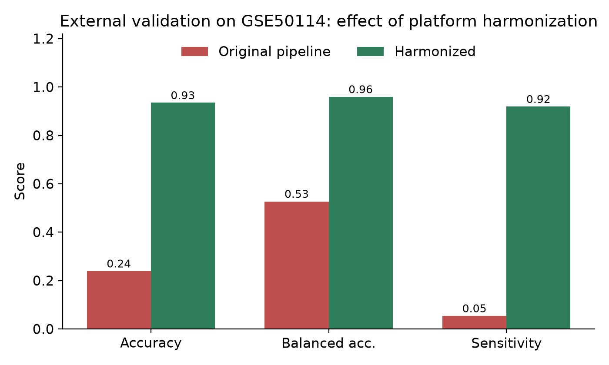

# Colorectal Adenoma vs Normal Mucosa: Gene-Expression Classifier

Machine-learning study on public GEO microarray data, with **cross-platform external validation**.

| | Dataset | Platform | Samples |
|---|---|---|---|
| Training | GSE8671 | Affymetrix HG-U133 Plus 2.0 | 64 (32 patients, paired normal + adenoma) |
| External test | GSE50114 | Agilent 4x44K (GPL6480) | 46 (37 adenoma, 9 normal) |

## Headline result

| Evaluation | Accuracy | Balanced acc. | Sensitivity | Specificity | ROC AUC |
|---|---|---|---|---|---|
| Internal, patient-grouped 5-fold CV | 1.00 | 1.00 | 1.00 | 1.00 | 1.00 |
| External, original pipeline | 0.24 | 0.53 | 0.05 | 1.00 | 1.00 |
| **External, harmonized pipeline** | **0.93** | **0.96** | **0.92** | **1.00** | **1.00** |



## The interesting part: why the first external test "failed"

The original model scored 100% in cross-validation but only 24% on GSE50114, while its ROC AUC was still 1.0.
AUC = 1.0 means the **ranking** was perfect; only the **threshold** was wrong. The cause is a platform batch effect:
GSE8671 holds raw Affymetrix intensities (values up to ~170,000) while GSE50114 holds Agilent log-ratios centred near 0.
A model fitted on one scale produced probabilities near 0 for every external sample (see `fig_probability_shift.png`).

**Fix**: log2-transform the Affymetrix data and z-score each gene *within its own dataset*. No labels are used in this step,
and the classifier is still trained only on GSE8671.

## Method
1. Map probes to gene symbols; keep the 10,784 genes shared by both platforms (`scripts/map_common_genes.py`, `prepare_gene_level_data.py`).
2. Harmonize per dataset (log2 + per-gene z-score).
3. Inside each CV fold: ANOVA F-test (`SelectKBest`) top-50 genes, standardize, L2 logistic regression (feature selection never sees test data). The earlier probe-level and gene-level scripts (`train_models.py`, `train_gene_level_model.py`) use the top-100 instead; the headline table above is the harmonized top-50 run.
4. **Patient-grouped** `StratifiedGroupKFold` so a patient's paired samples never split across train and test.
5. Fit on all GSE8671, freeze, predict GSE50114 once.

Top genes include Wnt-pathway genes such as AXIN2 and RNF43, consistent with the known role of Wnt signalling in adenomas.

## Limitations (stated honestly)
- Small cohorts; only 9 external normals, so specificity rests on few samples.
- All three internal models score 1.00, so internal CV cannot rank them.
- Per-dataset z-scoring is transductive (needs the new dataset's gene statistics); not usable for a single new patient.
  Future work: reference-based batch correction (ComBat / quantile normalization to a fixed reference).
- Research prototype, not a diagnostic tool.

## Differential expression, GO and KEGG (R workflow)
`scripts/deg_go_kegg.R` complements the Python pipeline with a classical DEG analysis of GSE8671:

1. Downloads GSE8671 with `GEOquery` and maps probes to gene symbols from the platform annotation.
2. Fits `limma` (paired design `~ patient + group`, Adenoma vs Normal; set `PAIRED <- FALSE` for the GEO2R-style two-group model).
3. Filters DEGs with adjusted p < 0.05 and |log2FC| >= 1; selects the top 50 by adjusted p.
4. Volcano plot (up / down / not significant) and a top-50 heatmap annotated Normal Mucosa vs Tumor / Adenoma.
5. Converts symbols to Entrez IDs with `bitr()` / `org.Hs.eg.db`, then runs GO Biological Process (`enrichGO`) and KEGG (`enrichKEGG`) with dot plots.

```bash
Rscript scripts/deg_go_kegg.R     # needs R >= 4.2 and internet access (GEO, KEGG); writes to results/deg/
```
Outputs in `results/deg/`: `GSE8671_limma_all_probes.csv`, `GSE8671_significant_DEGs.csv`, `GSE8671_top50_DEGs.csv`,
`symbol_to_entrez_map.csv`, `GO_BP_enrichment.csv`, `KEGG_enrichment.csv`, `volcano_plot.png`, `heatmap_top50_DEGs.png`,
`GO_BP_dotplot.png`, `KEGG_dotplot.png`, `sessionInfo.txt`. The script installs missing CRAN/Bioconductor packages on first run.
Note: these classical DEGs (whole-dataset statistics) are for biological interpretation only; they are **not** used to train the ML models, whose feature selection stays inside each CV fold to avoid leakage.

## Run it
```bash
pip install -r requirements.txt
python scripts/external_validation_harmonized.py   # reproduces the table and figures
streamlit run app.py                               # interactive dashboard
```
Earlier pipeline stages: `scripts/download_*.py`, `prepare_dataset.py`, `train_models.py`, `train_gene_level_model.py`.
Exploratory audits and sanity checks are kept in `scripts/archive/`.
